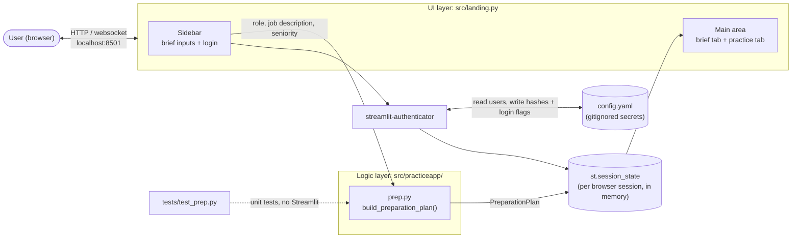
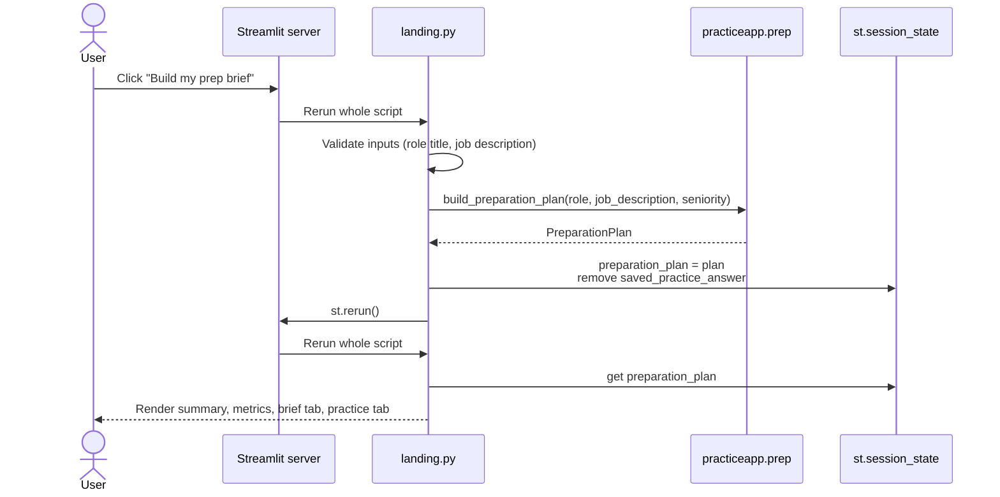
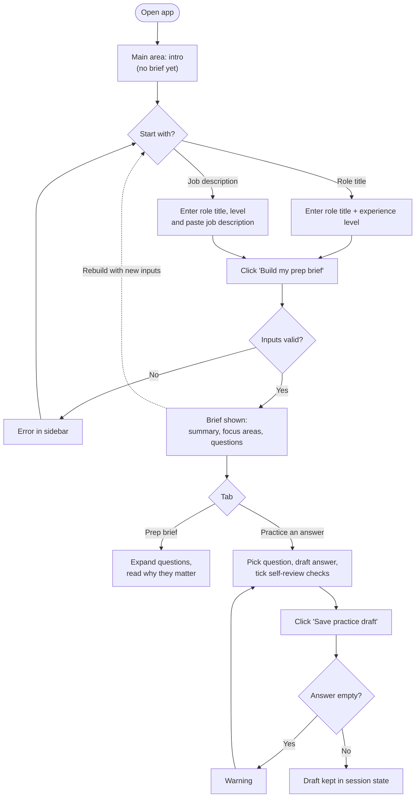
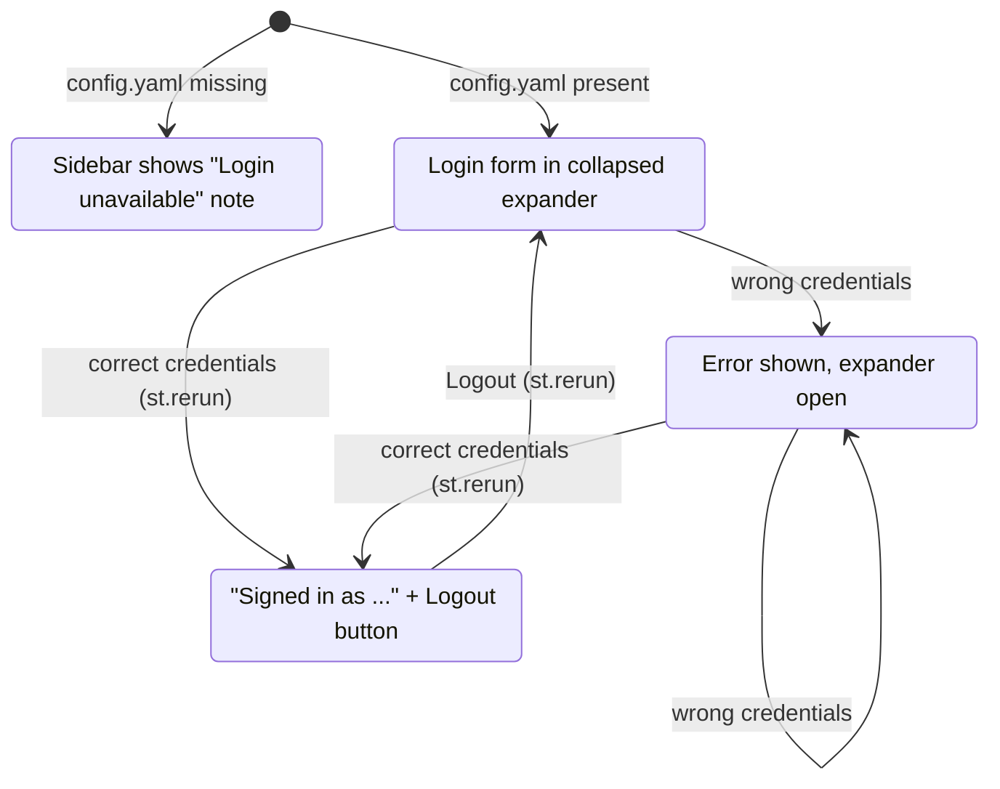
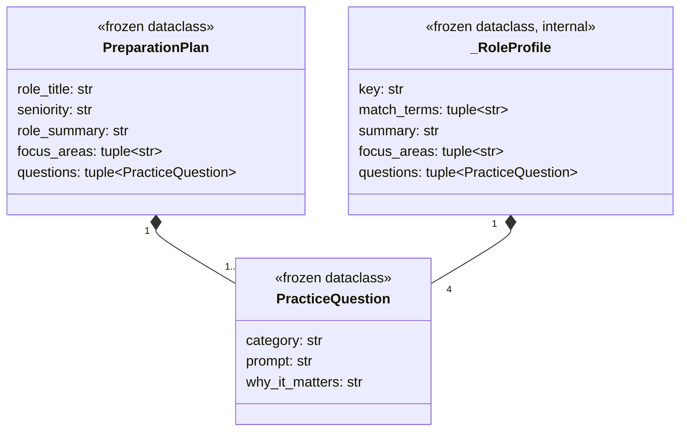
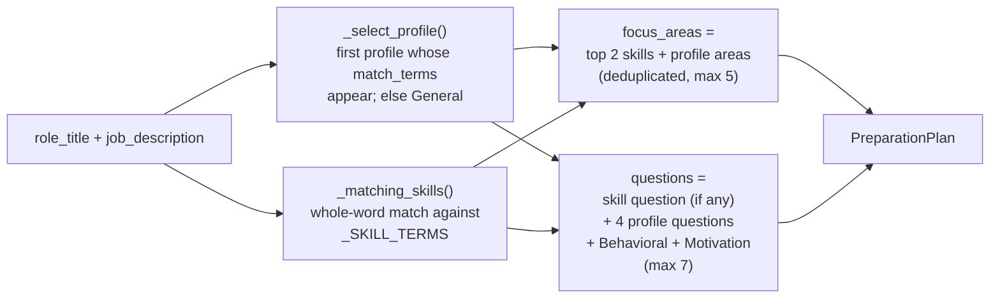

# Architecture

How Interview Practice Studio is put together: files, libraries, runtime behaviour and data.
Read this before adding a feature or user flow. Agent rules live in `AGENTS.md`; the review
notes for tutors live in `evaluation.md`.

Diagrams are written in [Mermaid](https://mermaid.js.org/), so they are plain text, versioned
with the code and rendered by GitHub and by VS Code (built-in preview, or the
"Markdown Preview Mermaid Support" extension). **Update the matching diagram in the same change
as the code.**

## 1. Overview

A single-page Streamlit app, run locally. It has two layers and one optional local file:



Key design decisions:

| Decision | Why |
|---|---|
| UI (`landing.py`) and logic (`practiceapp/`) are separate; no Streamlit imports in the package | Logic can be unit tested without running the app. |
| Prep content is deterministic (fixed role profiles + keyword matching) | Transparent, testable prototype; no AI service is called yet. |
| State lives only in `st.session_state` | No database needed for the prototype; nothing persists after the session ends. |
| Login is optional and isolated in the sidebar | Guests can use the whole app; the app still runs if `config.yaml` is missing. |
| Secrets in gitignored `config.yaml`, template in `config.example.yaml` | Cookie key and password hashes never reach git. |

## 2. File map

```text
PracticeApp/
├── src/
│   ├── landing.py            UI: the Streamlit page (sidebar, tabs, login). Entry point.
│   └── practiceapp/          Importable package with app logic (no Streamlit code).
│       ├── __init__.py       Empty; marks the package.
│       └── prep.py           Data classes + build_preparation_plan(). Role profiles, skill terms.
├── tests/
│   └── test_prep.py          unittest cases for build_preparation_plan().
├── docs/
│   └── streamlit-auth.md     Reference extract of the streamlit-authenticator API, given to agents.
├── config.example.yaml       Committed template for auth settings and users.
├── config.yaml               Real auth config (gitignored; created by copying the template).
├── pyproject.toml            Project metadata and dependencies (managed with uv).
├── uv.lock                   Exact locked dependency versions.
├── .python-version           Python version used by uv (3.15).
├── run_app.bat               Double-click launcher for Windows (runs the Streamlit command).
├── README.md                 What the app does and how to run it.
├── ARCHITECTURE.md           This file.
├── AGENTS.md                 Instructions shared by all AI coding agents.
├── CLAUDE.md                 Only "@AGENTS.md", so Claude Code reads the same instructions.
└── evaluation.md             Good practices collected for the tutors' review.
```

## 3. Technology stack

| Area | Technology | Used for | Where |
|---|---|---|---|
| Language | Python 3.15 | Everything | `.python-version`, `pyproject.toml` |
| Package / env manager | [uv](https://docs.astral.sh/uv/) (build backend `uv_build`) | Virtualenv, dependencies, running commands | `pyproject.toml`, `uv.lock` |
| UI framework | [Streamlit](https://streamlit.io/) | Page layout, widgets, session state, local web server | `src/landing.py` |
| Authentication | [streamlit-authenticator](https://github.com/mkhorasani/streamlit-authenticator) ≥ 0.4.2 | Login/logout widgets, bcrypt password hashing, auth cookie | `src/landing.py`, `config.yaml` |
| Config format | YAML | Auth cookie settings and users | `config.example.yaml`, `config.yaml` |
| Standard library | `dataclasses`, `re`, `pathlib` | Immutable plan objects, skill matching, config path | `prep.py`, `landing.py` |
| Testing | `unittest` (standard library) | Unit tests of the logic layer | `tests/` |
| Declared, not used yet | `openai`, `tiktoken`, `IPython` | Reserved for upcoming LLM features | `pyproject.toml` only |

## 4. How a page run works

Streamlit re-executes `landing.py` from top to bottom on **every** interaction (click, typing,
tab change). Local variables are lost between runs; only `st.session_state` survives. That is
why the plan and login status are stored there, and why the code calls `st.rerun()` right after
changing them (to redraw the page with the new state immediately).



### Session state keys

| Key | Set by | Contents |
|---|---|---|
| `preparation_plan` | "Build my prep brief" button | The current `PreparationPlan` |
| `saved_practice_answer` | "Save practice draft" button | `{"question", "answer", "checks"}`; cleared when a new brief is built |
| `practice_question`, `practice_answer` | Widgets (via `key=`) | Selected question, draft text |
| `review_context`, `review_actions`, `review_outcome` | Checkbox widgets | Self-review ticks |
| `authentication_status`, `name`, `username`, … | streamlit-authenticator | `None` = not tried, `False` = wrong credentials, `True` = logged in |

Because login only adds auth keys and never clears the others, logging in or out keeps the brief.

## 5. User flows



### Optional login



The authenticator also **writes** to `config.yaml`: it hashes plain-text passwords on first
login (`auto_hash`) and updates `logged_in` and `failed_login_attempts`. It sets a signed cookie
(name, key and expiry from `config.yaml`) so a returning user stays logged in.
`login_sleep_time=0` disables the library's 0.7 s pause on every rerun for guests.

## 6. Logic layer: data model



`build_preparation_plan(role_title, job_description="", seniority="Mid-level")` is the only public
function:



Role profiles (in match order): Software engineering, Product management, Data analysis,
Marketing, Customer success, General (fallback).

## 7. Extending the app

| To add… | Change | Keep in mind |
|---|---|---|
| A new role family | Add a `_RoleProfile` to `_ROLE_PROFILES` in `prep.py`, **before** "General" | Order matters: the first match wins. Add a test. |
| A recognised skill | Add it to `_SKILL_TERMS` | Matched as a whole word, case-insensitive. |
| New logic (e.g. LLM-generated questions or answer feedback) | New module in `src/practiceapp/` (e.g. `llm.py`) returning the existing dataclasses | No Streamlit code there; mock the API in tests; API key in a gitignored file or env var, never in git. |
| A new UI section or flow | `src/landing.py` (new tab, or a new page) | Store anything that must survive a rerun in `st.session_state`. Update the flow diagram in section 5. |
| Saved history for logged-in users | Persist `saved_practice_answer` keyed by `st.session_state["username"]` | Guests must keep working without it. Needs a storage choice (e.g. a local JSON/SQLite file, gitignored). |
| A dependency | `uv add <package>` | Updates `pyproject.toml` and `uv.lock`; add it to section 3. |

Commands: run `uv run streamlit run src\landing.py`; test `uv run python -m unittest discover -s tests`.
