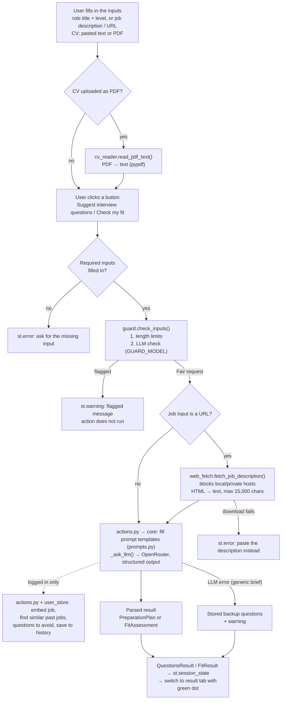

# Architecture

## Components

| Component | Location | Purpose |
|---|---|---|
| UI | `src/scanya_ae_afa_updated0209_1_6/landing.py` | The Streamlit page: three equal-height input panels (1 role/job + difficulty, 2 CV, 3 settings: model, max tokens, costs, temperature), a button below panels 1 and 2, results in tabs. Only draws, validates and shows; no feature logic. Run with `start_app.bat`. |
| Actions | `src/scanya_ae_afa_updated0209_1_6/actions.py` | The logic behind the two buttons: `suggest_questions()` and `check_fit()` call `core.py` and, for logged-in users, use and update the history (`user_store.py`). No Streamlit code. |
| Core logic | `src/scanya_ae_afa_updated0209_1_6/core.py` | LLM features: builds a `PreparationPlan` (role, seniority, summary, `PracticeQuestion`s) and a `FitAssessment` (score, reasoning, cover letter); embeddings. All chat calls go through `_ask_llm()`. No Streamlit code. |
| Prompts | `src/scanya_ae_afa_updated0209_1_6/prompts.py` | All LLM prompt strings as constants (`*_TEMPLATE` ones are filled with `.format()`), the difficulty instructions, and 4 alternative job-opening system prompts (few-shot, Chain-of-Thought, role, constrained) not used by the app yet. |
| Security guard | `src/scanya_ae_afa_updated0209_1_6/guard.py` | `check_inputs()` runs before every action: length limits, then an LLM check (cheapest model) for prompt injection, off-topic or harmful input. |
| Web fetch | `src/scanya_ae_afa_updated0209_1_6/web_fetch.py` | If the job input is a URL, downloads the page (`httpx`) and extracts its text (`beautifulsoup4`). Blocks URLs to local/private networks. |
| Pricing | `src/scanya_ae_afa_updated0209_1_6/pricing.py` | Cost estimate before sending (prices from the OpenRouter models endpoint × max tokens) and the real cost of every request (reported by OpenRouter), shown in the Settings panel; `format_usd()` for display. |
| CV reader | `src/scanya_ae_afa_updated0209_1_6/cv_reader.py` | Extracts the text from an uploaded CV PDF (`pypdf`). |
| Auth | `src/scanya_ae_afa_updated0209_1_6/auth.py` | Optional login with `streamlit-authenticator`: `login_area()` draws the login / create-account box; creates `config.yaml` on first start. |
| User store | `src/scanya_ae_afa_updated0209_1_6/user_store.py` | Per-user history of job profiles in JSON, with embeddings: a lightweight vector store (numpy cosine similarity). |
| Accounts | `config.yaml` | User accounts (bcrypt-hashed passwords) and the login-cookie key. Committed on purpose: demo account for reviewers. |
| User data | `data/users/<username>.json` | One file per user: their job profiles (input, embedding, all questions, latest fit). Committed on purpose (demo data). |
| Config | `src/scanya_ae_afa_updated0209_1_6/config.py` | `get_client()`: OpenAI SDK client for OpenRouter or OpenAI, keys from `.env`. |
| Streamlit config | `.streamlit/config.toml` | UI settings read at startup (currently only a smaller top padding). |
| Prompt-log hook | `.claude/hooks/log_prompt.py` | Appends every prompt sent to Claude Code to `.claude/prompt-log/prompts.md` (path based on the script's own location, so it is the same log whatever folder Claude Code works in). |
| Task tracker | `TASKS.md` | Status of the mandatory and optional tasks from `115.md`. |
| README | `README.md` | Features, setup, how to run, demo account. |

## How they work together

The user fills in the inputs at the top of `landing.py` and clicks one of two buttons. Each button first runs `guard.check_inputs()` on the inputs it uses; if they are flagged, a warning is shown and nothing else runs. Otherwise `landing.py` calls `actions.suggest_questions()` or `actions.check_fit()`, which do the work described below and return a result object (`QuestionsResult` / `FitResult`) that the tab shows. **Suggest interview questions** depends on the mode:

- **Generic role title** → `core.build_preparation_plan_generic()` sends the role title, experience level and difficulty to the LLM. If the call fails, it returns stored backup questions instead (with `fallback_reason` set, shown as a warning).
- **Specific job opening** → `core.build_preparation_plan_opening()` sends the job description, with prompts from `prompts.py`, to OpenRouter via `config.get_client()` and gets a structured plan back. If the input is a URL, `web_fetch.py` first replaces it with the page text. Errors are shown in the UI with `st.error`.

Both return a `PreparationPlan`. **Check my fit & write a cover letter** (both modes) calls `core.assess_fit_and_write_cover_letter()` with the CV and the job (in generic mode, a stand-in description from `core.describe_generic_role()`), which returns a `FitAssessment`. Each result is stored in `st.session_state` and shown in its own tab. Tabs, in order: "Potential questions", "Practice interview" (a placeholder, its code is commented out), "Fit check & cover letter" and "My history".

**Logged-in users** (optional, `auth.py`) also get a history, handled in `actions.py`. Before generating questions, the job is embedded (`core.embed_text()`; job-opening mode: the job text, generic mode: the role title only) and compared with the user's past job profiles (`user_store.find_similar()`): questions from profiles at least 70% similar are passed as `avoid_questions`, so the LLM generates new ones, and the 3 most similar other profiles (≥ 50%) are suggested under the questions. A fit check does the same search but only to compare: the 3 most similar other profiles that have a fit check are shown with their scores ("Similar jobs you checked before"); nothing is avoided, since the score should stay consistent. Each brief and fit result is then saved to the user's job profile (`user_store.save_brief()` / `save_fit()`) and listed in "My history". If the embedding call fails, the feature runs without history.

## Modules and functions

Imports go one way, in layers:

- **Page:** `landing.py` → `actions.py`, `guard.py`, `auth.py`, `cv_reader.py`, `pricing.py` (cost display), `user_store.py` (history tab), `core.py` (model lists and settings ranges).
- **Logic:** `actions.py` → `core.py` + `user_store.py`; `guard.py` → `core._ask_llm()`.
- **LLM and helpers:** `core.py` → `prompts.py`, `web_fetch.py`, `config.py`, `pricing.py` (cost recording). `user_store.py` uses no other app module.

Only `landing.py` and `auth.py` use Streamlit, so everything else can be run and tested with plain Python.

### `landing.py` (UI)

Streamlit reruns the whole script top to bottom on every click. On each run it:

1. Draws the header and the login box (`auth.login_area()`, returns the username or `None`).
2. Draws the three input panels and the two buttons below panels 1 and 2. The Settings panel holds the model select box (options from `core.AVAILABLE_MODELS`) and a placeholder for the costs.
3. If a button was clicked: starts cost tracking, validates the inputs, runs the guard (`_check_with_guard()`), then calls `actions.suggest_questions()` / `actions.check_fit()` inside a spinner. The result object goes into `st.session_state` (`"questions_result"` / `"fit_result"`), errors into `st.error`.
4. Fills the cost placeholder: estimate, last action, session total (`pricing.py`).
5. Draws the tabs from whatever is in `st.session_state`, so results survive later reruns. After a button produces a result, `_show_new_result()` switches to its tab and marks it with a green dot (`RESULT_TABS`, `NEW_RESULT_DOT`); `_on_tab_click()` removes the dot when the user opens it.

### `actions.py` (logic behind the buttons)

| Function / class | What it does |
|---|---|
| `suggest_questions(username, role_title, seniority, job_description, difficulty, model, temperature, max_tokens)` | Generic mode if `job_description` is empty, else job-opening mode. Logged in: `_job_text()` (downloads a URL once) → `_embed_for_history()` → `user_store.find_similar()` → `questions_to_avoid()`. Then `core.build_preparation_plan_generic()` / `_opening()` with those `avoid_questions`; logged in and not a fallback: `user_store.save_brief()`. Returns a `QuestionsResult`. |
| `check_fit(username, cv, role_title, seniority, job_description, model, temperature, max_tokens)` | `_job_text()` → `core.assess_fit_and_write_cover_letter()`. Logged in: embed, look up similar earlier fit checks (`closest_other_profiles(only_with_fit=True)`, before saving), `user_store.save_fit()`. Returns a `FitResult`. |
| `QuestionsResult`, `FitResult` | What the tabs show: the plan + avoided count + closest roles, or the fit + similar earlier fit checks. |
| `_history_key()`, `_job_text()`, `_embed_for_history()` | History key (role + level, or the job input); job text for the LLM (stand-in description in generic mode); embedding (generic mode: role title only, see Decisions). |

### `core.py` (logic)

| Function / class | Called by | What it does |
|---|---|---|
| `build_preparation_plan_generic(role_title, seniority, difficulty, model, temperature, avoid_questions, max_tokens)` | `actions.suggest_questions()` (generic mode) | Fills `GENERIC_ROLE_USER_PROMPT_TEMPLATE` → `_ask_llm(GENERIC_ROLE_SYSTEM_PROMPT, ..., _LLMPlan)` → `PreparationPlan`. On any error: `_fallback_plan()`, where `_select_profile()` picks the first `_ROLE_PROFILES` entry whose keywords match the title and returns its questions plus two general ones, with `fallback_reason` set. |
| `build_preparation_plan_opening(job_description, difficulty, model, temperature, avoid_questions, max_tokens)` | `actions.suggest_questions()` (job-opening mode) | `resolve_job_text()` → fills `JOB_OPENING_USER_PROMPT_TEMPLATE` with the job text and difficulty instruction → `_ask_llm(JOB_OPENING_SYSTEM_PROMPT, ..., _LLMPlan)` → converts the result into a `PreparationPlan`. |
| `assess_fit_and_write_cover_letter(cv, job_description, model, temperature, max_tokens)` | `actions.check_fit()` | `resolve_job_text()` → fills `FIT_USER_PROMPT_TEMPLATE` → `_ask_llm(FIT_SYSTEM_PROMPT, ..., FitAssessment)`. |
| `describe_generic_role(role_title, seniority)` | `actions._job_text()` (generic mode) | Fills `GENERIC_ROLE_JOB_TEMPLATE`: a short stand-in job description ("no specific posting, target role: …, don't name a company"). |
| `resolve_job_text(job_input)` | the LLM functions above, and `actions._job_text()` (once up front, so the same text is embedded and sent) | Returns the input as is, or, if `web_fetch.is_url()`, the page text from `web_fetch.fetch_job_description()`. |
| `_ask_llm(system_prompt, user_prompt, schema, model, temperature, max_tokens)` | the LLM functions above, and `guard.check_inputs()` | The only place that sends chat requests: `config.get_client("OpenRouter")`, then `chat.completions.parse(response_format=schema)` (`temperature`/`max_tokens` only sent when set); records the cost (`pricing.record_cost()`); returns the parsed Pydantic object or raises `ValueError` (also for a cut-off answer). |
| `embed_text(text)` | `actions._embed_for_history()` (logged in) | Embedding vector of the text from `EMBEDDING_MODEL` (`qwen/qwen3-embedding-8b`, 4096 numbers). |
| `PracticeQuestion`, `PreparationPlan` | — | Dataclasses for one question and the whole brief (what the UI renders). |
| `_LLMPlan`, `FitAssessment` | `_ask_llm()` | Pydantic schemas the LLM must answer in (structured output). |

### `user_store.py`, `auth.py`, `guard.py`, `web_fetch.py`, `cv_reader.py`, `config.py`, `prompts.py`

- `user_store.py`: a job profile = one distinct job input (`make_key()`: case and spaces ignored) with its `embedding`, all `questions` generated for it and the latest `fit`. `find_similar(username, embedding)` returns all profiles with their cosine similarity (numpy), most similar first; `questions_to_avoid()` takes the questions of profiles ≥ `SEEN_BEFORE_SIMILARITY` (0.7, at most 20); `closest_other_profiles()` the top 3 other profiles ≥ `MIN_RELATED_SIMILARITY` (0.5), optionally only those with a saved fit check (`only_with_fit=True`, for the fit tab). `save_brief()` / `save_fit()` add results and write `data/users/<username>.json`.
- `auth.login_area()`: draws log in / create account (or "signed in as" + logout) and returns the username or `None`. `_get_authenticator()` creates `config.yaml` if missing (no users, random cookie key) and builds the `streamlit_authenticator.Authenticate` from it.
- `guard.check_inputs(role_title, seniority, job_description, cv)`: returns `FAIR_REQUEST` (`"Fair request"`) if fine, else a message; callers compare with `!= guard.FAIR_REQUEST`. Checks `MAX_LENGTHS`, then asks `GUARD_MODEL` (via `core._ask_llm()`) for a `GuardVerdict` (`is_valid`, `reason`) using `GUARD_SYSTEM_PROMPT`. If that call itself fails, the check is skipped and `FAIR_REQUEST` is returned (fail open), so the generic fallback still works when the API is down.
- `web_fetch.is_url(text)`: true for a single `http(s)://` link. `fetch_job_description(url)`: downloads the page, strips scripts/menus, returns at most 15,000 characters; raises `ValueError` if unreachable, almost empty, or pointing to a local/private address (`_block_private_hosts()`, checked on every redirect too).
- `cv_reader.read_pdf_text(file)`: called by `landing.py` when a PDF is dropped on the CV uploader; returns the text of all pages, or raises `ValueError` for unreadable or scanned (text-less) PDFs. The result replaces the pasted CV text.
- `config.get_client(provider)`: loads `.env` and returns an `OpenAI` client pointed at OpenRouter (or OpenAI).
- `prompts.py`: only constants, no logic.

### Example: "Suggest interview questions" with a job URL

`landing.py` → `guard.check_inputs()` (1 request to the cheapest model) → `actions.suggest_questions()` → (logged in: download the page once, embed it, search the history) → `core.build_preparation_plan_opening()` → `resolve_job_text()` → `web_fetch.fetch_job_description()` → back in `core`, prompt filled from `prompts.py` → `_ask_llm()` → `config.get_client()` → OpenRouter (1 request: structured answer) → `_LLMPlan` → `PreparationPlan` → (logged in: `user_store.save_brief()`) → `QuestionsResult` → `st.session_state` → "Potential questions" tab.

## Decisions

- **uv** for dependency and environment management, with Python 3.15 and a committed `uv.lock`.
- **Streamlit** for the UI, as required by the task.
- **Page width**: Streamlit only has "centered" (too narrow for three input columns) and "wide" (full screen), so `landing.py` uses "wide" plus one small CSS rule capping the content at `MAX_PAGE_WIDTH` (1200 px). The only custom CSS in the app.
- **API keys** are read from a git-ignored `.env` file; `.env.example` documents the required variables.
- **Both modes use the LLM, stored questions are the backup**: the generic mode sends role + seniority instead of a job description. If its LLM call fails, the stored role-profile questions are shown with a warning, so the user always gets a brief. (The job-opening mode has no backup: without a role title there is no profile to pick, so it shows an error.)
- **Structured LLM output**: `client.chat.completions.parse(response_format=_LLMPlan)` makes the model return JSON matching a Pydantic schema, which is parsed straight into `PracticeQuestion` objects. `provider.require_parameters = true` makes OpenRouter use only providers that support this.
- **Page and logic separated**: `landing.py` only draws the page, validates inputs and shows results; the work behind the buttons is in `actions.py`, with no Streamlit code, so the whole flow (LLM + history) can be tested with a plain Python script.
- **One shared LLM helper** (`_ask_llm()`): every feature sends one system + user message and gets a parsed schema back, so API code, error handling and OpenRouter options live in one place.
- **CV PDFs are read by the app with `pypdf`**, like URLs: the LLM only receives text. Cheaper and simpler than sending the PDF to the model; scanned PDFs are not supported (the user is asked to paste the text).
- **URLs are fetched by the app, not the LLM**: the chat API cannot open links, so the app downloads the page itself and sends the text (capped at 15,000 characters). Chosen over OpenRouter's web plugin because it reads the exact page, costs nothing extra and is easy to test. Pages that need a login or JavaScript (e.g. LinkedIn) give an error asking the user to paste the description.
- **Fit check and cover letter in one LLM call**: one JSON object with three fields (score, reasoning, cover letter) keeps the parts separate while costing a single request. In generic mode a stand-in job description is sent instead of a posting, so the same function and prompt serve both modes.
- **Model choice**: the user picks one of `core.AVAILABLE_MODELS` (the 3 course models, all with structured-output support) in the Settings section; it is passed to every LLM call.
- **Temperature is opt-in**: the course models are reasoning models and reject `temperature`. A toggle in the Settings section switches to `core.TEMPERATURE_MODELS` (models on the key's allow-list that accept it) and shows a warning; `temperature` is only sent when set, because `require_parameters` would otherwise reject the call.
- **Difficulty in the user message, not the system prompt**: the system prompt holds the fixed task and format; per-request choices (job, difficulty) go in the user message. This keeps system prompts stable and comparable.
- **Security guard = length limits + LLM check, warn and stop**: plain-Python limits stop oversized inputs for free; an LLM check catches what rules can't (prompt injection, off-topic requests). It always uses the cheapest course model, so the user's model choice can't weaken it. Flagged input shows a warning and the action does not run, so the user can fix the input. URLs to local/private networks are blocked in `web_fetch.py`, where the download happens.
- **Optional login with `streamlit-authenticator`**: the app works fully without an account; logging in only adds the history. Accounts sign up in the app; passwords are stored as bcrypt hashes in `config.yaml`.
- **Vector store = one JSON file per user + numpy (no vector DB library)**: history and embeddings live together in one readable file, with no extra dependency; cosine similarity is a few lines of numpy. Fine for a personal tool (hundreds of profiles per user); a library like ChromaDB would only pay off at much larger scale. Per-user storage makes "seen before" mean "*you* prepared for a similar job". Thresholds measured with real embeddings (similar postings ~0.76, unrelated ~0.35-0.50). Generic mode embeds the role title only: with the stand-in description's fixed template text (or even a shared level word like "Mid-level") unrelated roles scored 0.66-0.74 and counted as "seen before"; with the title only they score ~0.46, similar roles 0.77-0.88.
- **Demo data committed to git**: `config.yaml` (demo account, dummy password, hashed) and `data/` are committed so reviewers can log in and see a history. A real deployment would git-ignore both.
- **Max tokens is a user setting with a measured range** (1,000-8,000, default 4,000): it limits each answer including the model's hidden reasoning; real answers use ~450-1,050 output tokens. A cut-off answer becomes a clear "increase Max tokens" error (`_ask_llm()`).
- **Prices: estimate from the models endpoint, real cost from OpenRouter**: the estimate (before clicking) uses per-token prices from `https://openrouter.ai/api/v1/models`, fetched once per app run; the real cost uses `usage.cost` from each response, which equals tokens × those prices. Every request is counted (guard, embedding, main call). Costs are collected per Streamlit session thread (`threading.local`), so simultaneous users don't mix their totals.
- **Prompts in one file** (`prompts.py`), so they are easy to find, compare and replace. Alternative system prompts share the same output fields, so they can be swapped without code changes.

## Diagram: from user input to LLM output

Flow of the two buttons in `landing.py` (renders on GitHub; in VS Code the Markdown preview needs the "Markdown Preview Mermaid Support" extension).

Note: the guard checks the inputs **as typed**. For a URL that is the link itself, not the downloaded page, so text hidden in a web page (indirect prompt injection) is not checked by the guard. A pasted description and the CV (also from a PDF) are checked.
